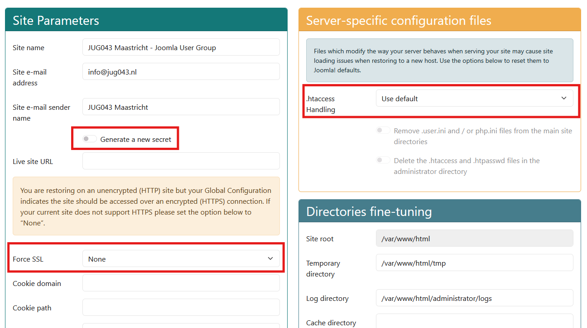

# JUG043 Joomla MCP demo – 3 POC-omgevingen in Docker

Drie proof-of-concepts die laten zien hoe een AI-chat (OpenCode) via MCP met een
Joomla website (via Akeeba-restore) kan praten. Elke POC bestaat uit **2 compose-stacks**
(een *website*-stack en een *opencode*-stack) en heeft een variant voor de **laptop**
(Windows + Docker) en voor de **Raspberry Pi 5** (Ubuntu + Docker).

[De presentatie staat hier](assets/pdf/20261017_Joomla_MCP_opties_JUG043_v1.pdf)

| POC | Map | Hoe praat OpenCode met Joomla? | Web | OpenCode | MCP-server |
|---|---|---|---|---|---|
| segmented | `JOOMLA_mcp_poc_segmented_DOCKER` | via een eigen Python MCP-server die vai de Joomla! websiet API leest | 9180 | 4196 | 9100 |
| senso | `JOOMLA_mcp_poc_senso_DOCKER` | via de Joomla Web Services API (`/api/index.php/v1/mcp`) | 9280 | 4296 | – |
| onepoint | `JOOMLA_mcp_poc_onepoint_DOCKER` | direct met een Joomla-component (`com_mcpserver`) | 9380 | 4396 | – |

De poorten zijn uniek, dus alle drie de POC's kunnen tegelijk draaien.

**Waar staat wat?** Dit README bevat alleen wat voor *alle* POC's geldt.
POC-specifieke zaken staan in `README.md` in de POC-map; de concrete commando's per
variant staan in `deploy_on/_localhost_windows_docker_*/README.md` (laptop) en
`deploy_on/_rpi5_ubuntu_docker_*/README.md` (Raspberry Pi).

---

## 1. Voorwaarden

- Docker met Docker Compose v2 (reeds geïnstalleerd op laptop en Pi).
- Een Akeeba-backup (`.jpa`) van de Joomla-site. Die zit **niet** in de zip.
- Internettoegang voor het ophalen van images (`joomla:6-apache`, `mariadb:10.11`,
  `ghcr.io/anomalyco/opencode`).
- Optioneel: `OPENCODE_API_KEY` (de gratis OpenCode Zen-modellen werken zonder
  betaalmodellen; aanmelden op https://opencode.ai/auth). 
  Je kunt OpenCode ook zonder API key gebruiken

## 2. Het `.env`-bestand (voor alle POC's gelijk)

Per variant staat in `env/` een `.env.example`. Kopieer die naar `env/.env`
(dit bestand is gedeeld door de website- én de opencode-stack van die variant).

| Variabele | Waarde |
|---|---|
| `MYSQL_DATABASE` | `joomla` |
| `MYSQL_USER` | `joomla` |
| `MYSQL_PASSWORD` | `joomla` (moet gelijk zijn aan wat je in Akeeba invult) |
| `MYSQL_ROOT_PASSWORD` | `root` |
| `DB_TABLE_PREFIX` | de prefix van de gerestorede site (staat in `configuration.php` als `$dbprefix`) |
| `JOOMLA_ADMIN_PASSWORD` | zelf kiezen (alleen gebruikt bij een verse Joomla-installatie, niet bij een restore) |
| `OPENCODE_API_KEY` | optioneel |
| `MCP_READER_PASSWORD` | alleen **segmented**: zie het POC-README |
| `DATA_BACKEND`, `JOOMLA_API_*` | alleen **segmented**; standaard `db` laten staan |

## 3. Akeeba-restore (voor alle POC's gelijk)

Voorwaarde: `joomla-www/` is leeg, en `joomla-akeeba/akeeba/` bevat `kickstart.php`
+ je `.jpa`. Bij het starten van de Joomla-container worden die naar
`/var/www/html` gekopieerd en wordt `kickstart.json.php` aangemaakt met
`MYSQL_PASSWORD`. Daarna kun je kickstart.php starten en het `MYSQL_PASSWORD` invullen.

1. Open `http://<host>:<webpoort>/kickstart.php` en laat Kickstart het archief uitpakken.
2. Start de Akeeba-installer en vul de database in:

   | Veld | Waarde |
   |---|---|
   | Database type | MySQLi |
   | Database server | **`mariadb`** (niet `localhost`) |
   | Gebruikersnaam | `joomla` |
   | Wachtwoord | `joomla` |
   | Databasenaam | `joomla` |

3. Stel bij **Site Parameters** / **Server-specific configuration files** in
   - **Force SSL: None**
   - **Generate a new secret: uit**
   - **.htaccess Handling: Use default**
   (zie  in elke POC-map):

4. Rond de restore af en verwijder daarna (zoals Akeeba vraagt) de `installation`-map.
5. Front-end: `http://<host>:<webpoort>/` · Back-end: `http://<host>:<webpoort>/administrator/`

Krijg je toch een HTTP 500: hernoem `joomla-www/.htaccess` naar `.htaccess.bak`.

`<host>` is `localhost` op de laptop en `rpi5-ub2404-001-wire` op de Pi (of de naam zoals jij de Pi genoemd hebt)

## 4. De scripts in `compose_scripts/`

| Script | Doet |
|---|---|
| `rebuild_and_start_all_containers.*` | Maakt zo nodig het externe Docker-netwerk aan, bouwt alles opnieuw (`--no-cache --pull`) en start met `--force-recreate`. Op de Pi wist het ook `./joomla-www` (`sudo rm -rf`). Gebruik dit bij de **eerste** start. |
| `start_all_containers.*` | Valideert de compose-config en doet `up --build --detach`. Dagelijks gebruik. |
| `stop_all_containers.*` | `docker compose down` (volumes blijven behouden). |
| `update_all_apps_in_containers.*` | `pull` + `build --no-cache --pull` + `up` en daarna **`docker image prune -af`**: dat ruimt álle ongebruikte images op de hele Docker-host op, niet alleen die van dit project. |

Laptop: `.cmd` (roept de `.ps1` aan). Pi: `.sh`. Alle scripts schrijven een
`docker_build_<datum>.log` in de map waar ze draaien.

## 5. Opnieuw beginnen

- Alleen de site opnieuw restoren: stack stoppen, `joomla-www/` leegmaken, starten, Kickstart opnieuw doorlopen.
- Ook de database wissen: in de website-map
  `docker compose --env-file <pad-naar>/.env down -v` (`-v` verwijdert het `mariadb_data`-volume, zodat ook de `init/`-scripts opnieuw draaien).
- OpenCode-geschiedenis wissen: inhoud van `opencode/data/` verwijderen (behalve `.gitkeep`) terwijl de container uit staat.

## 6. Gebruikersgegevens anonimiseren (optioneel, vóór een demo)

`mariadb/mgmt_scripts/anonymize_members.sh` (bash, onomkeerbaar op de kopie; Super Users blijven ongemoeid).
Standaard zoekt het de container `joomla-mariadb-segmented`; voor de andere POC's:
`MARIADB_CONTAINER=joomla-mariadb-onepoint` resp. `joomla-mariadb-senso` meegeven.
Eerst `--report` draaien. Het script zoekt `.env` op `../../env/.env` (ten opzichte van het script); dat klopt op de Pi,
op de laptop geef je `ENV_FILE=<pad naar env/.env>` mee.

## 7. Bekende valkuilen/aandachtspunten

- OpenCode (poorten 4196/4296/4396) heeft geen wachtwoord; wie op je netwerk zit kan erbij.
- Chatvragen en tool-resultaten gaan naar de cloud-modelprovider. Anonimiseer de data eerst!

